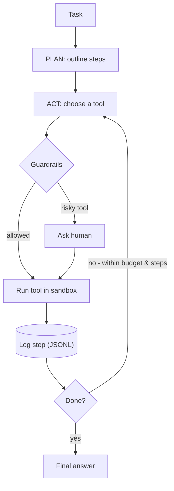

# AI agent for long-horizon tasks


An agent that finishes a multi-step task on its own — **plan → act → check** — while
staying inside hard guardrails. Built on the **Claude API tool-use loop**.

## Architecture



## What this demonstrates
- **loop engineering** — a real tool-use loop, not a single prompt
- **sandboxing** — file tools are confined to `./workspace`
- **guardrails** — tool allowlist, `max_steps`, token **budget**, human confirmation for risky tools
- **monitoring** — every step is logged to `logs/run-*.jsonl`
- **testing** — a small task suite with a pass rate

## Setup
```bash
python -m venv .venv && source .venv/bin/activate
pip install -r requirements.txt
cp .env.example .env          # add your ANTHROPIC_API_KEY
```

## Run it
```bash
# Interactive (asks before risky actions like writing files)
python agent.py "Compute 42 * 19, then write the result and a one-line note to result.md"

# Unattended (skips the human gate, still logged)
python agent.py "..." --auto --max-steps 15 --budget 80000
```

## Test it
```bash
python tasks.py               # runs the task suite, prints a pass rate
```

## The tools
Defined in [`tools.py`](./tools.py): `write_file`, `read_file`, `list_files`, `calculator`.
`write_file` is marked **risky** and requires confirmation unless `--auto` is set.
Adding a tool = add one function + one schema entry.

## Level up (production isolation)
This repo uses a *path-sandboxed* workspace. To run genuinely untrusted code, swap the
file tools for a real isolated runtime:
- **E2B** — runs the agent's code in an isolated microVM (has a Pydantic AI integration)
- **Docker** — run tools in a throwaway container

## "Done when" checklist
- [ ] It runs 10+ steps without you touching it
- [ ] Its actions run in a sandbox and every step is logged
- [ ] It passes the small test set of tasks

## Start here
Hugging Face — *AI Agents Course* (free): https://huggingface.co/learn/agents-course

---
<sub>Part of a 3-part AI-engineering series by **Ayoub AMRANI** ·
[rag-over-your-docs](https://github.com/yurri775/rag-over-your-docs) ·
[deploy-open-llm](https://github.com/yurri775/deploy-open-llm)</sub>
